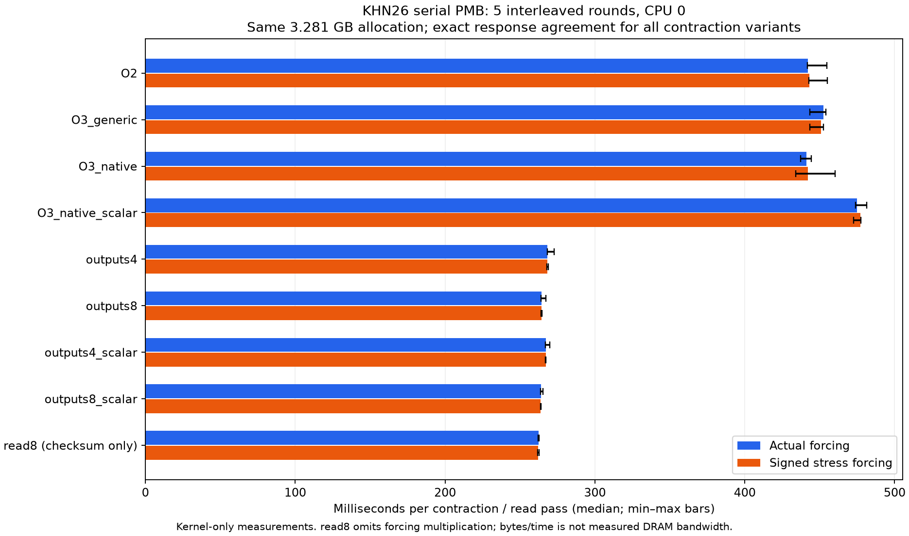
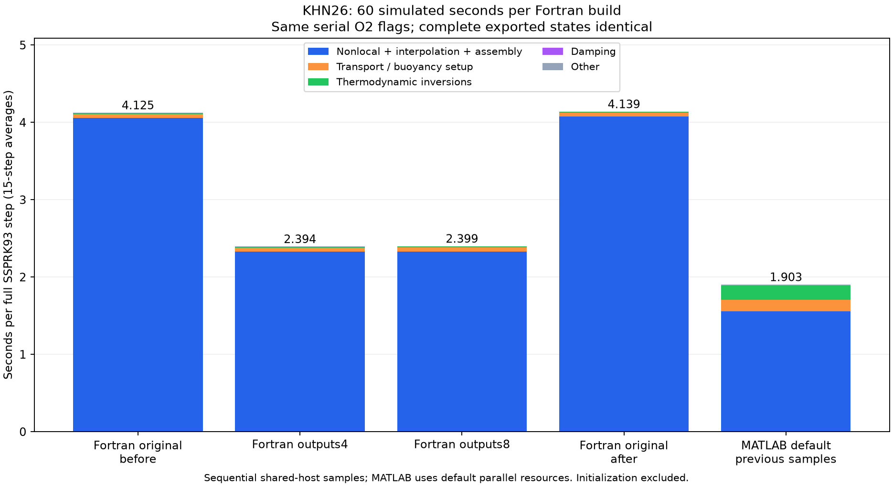
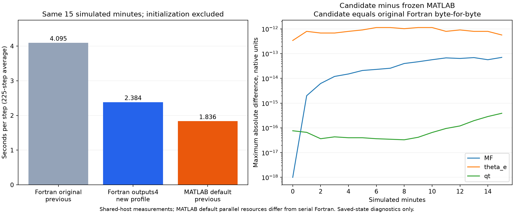

# KHN26 one-minute MATLAB / serial Fortran section comparison

Measured 2026-10-06 on `migration/v020-preparation`. Same Manaus 1342/KHN26
singleACE case, full 101-ACE geometry/basis, +1 K saturated bubble, initial
ACE 1 MF pulse 0.03, mean-MF correction, no precipitation or MF diffusion.
Each run advances 60 simulated seconds: 15 full 4 s SSPRK93 steps and 135
tendency/nonlocal basis evaluations. Fortran uses production real64 `-O2`
without OpenMP/debug checks/fast-math. MATLAB uses the original three-hour
`matlab -batch`/default settings, natural computational-thread cap 80, no
thread setter or CPU pinning. A thread cap is not measured CPU utilization.

## Recorded Fortran version and acceptance status

The production Fortran source used by these measurements is the code at
`2af198a` (`fortran: use binary interval search for PCHIP`). Its
`fortran/src/ace_module.F` SHA256 is
`e185be73ed0df2757df72e10317d6f12abf39477e3de795b65e82d733b1c6c5d`.
No production Fortran source change is included with this results record.
The four-output candidate is generated in isolated workspaces by the
committed test tools; its exact module hash and fifteen-minute acceptance
are recorded below. It has not been adopted into production or tested for
three hours.

The completed fifteen-minute evidence is original serial Fortran
4.094963 s/step, isolated four-output Fortran 2.384060 s/step, and previous
default MATLAB 1.835955 s/step. The candidate reproduces all 16 original
Fortran states exactly. The single-thread MATLAB attempt was explicitly
cancelled by the developer and contributes no completed benchmark timing.
Its [tracked cancellation record](../../tests/khn26/matlab_single_cancellation.json)
preserves configuration, progress and artifact hashes independently of the
ignored runtime workspace. Measurements remain samples on a shared host.

## Updated method: preserve the original expression and interleave controls

The initial 1.72001 instrumented/control ratio below did not establish a
fixed timer overhead. A follow-up with fresh MATLAB processes measured
unchanged controls at 3.056787 and 23.349767 s/step, split-only at 2.362973,
the previous split/timer version at 2.020840 and an unsplit timer version at
1.912971. All state streams were exact. This large variation prevents
attributing the previous slowdown solely to expression splitting or timers.

The revised profiler leaves the entire original `NONLOCAL_RESPONSE`
expression intact, including its PMB reduction and interpolation, and times
the function as a whole. One initialized MATLAB process reuses the same
unchanged PMB/model allocation. Five one-minute samples restart from the
same initial state in order: control, unsplit profile, control, unsplit
profile, control. Wrapper/JIT context differs from the original script,
so uninstrumented controls use the same wrapper context. No thread limit
setter or affinity restriction is added.

| Same-allocation measurement | Median s/step | Observed range s/step |
| --- | ---: | ---: |
| Three original-expression controls | 2.036342 | 1.789522–2.271917 |
| Two unsplit profiles | 1.902559 | 1.875705–1.929413 |

The profiled range lies within the control range. This supports using the
less intrusive method without applying a scalar correction; it does not
prove zero overhead or that profiling makes the model faster.

A fresh serial production Fortran profile was then run for 60 seconds with
the same numerical settings. Its integration took 59.290024 s, or 3.952668
s/step, including 3.870663 s/step in PMB alone (97.9253%). Initialization
was 36.505823 s, including 4.495492 s of packing, separately from integration.
The updated additive comparison combines nonlocal response, interpolation
and tendency assembly because MATLAB now retains that expression intact:

| Aggregated section | Fortran serial ms/step | MATLAB default ms/step |
| --- | ---: | ---: |
| Nonlocal response, preparation, interpolation and assembly/mask | 3888.177 | 1559.151 |
| Transport and other buoyancy/setup, excluding inversion | 49.042 | 143.441 |
| Thermodynamic inversions | 12.816 | 187.336 |
| Damping | 0.252 | 0.655 |
| Other driver/state-update/reporting/timer overhead | 2.382 | 11.975 |
| Complete integration | 3952.668 | 1902.559 |

MATLAB values are component medians over two samples (equivalent to their
mean); Fortran values are a single fresh run's 15-step averages. All five
paired MATLAB samples, five fresh-process diagnostic samples and the new
Fortran run reproduce their respective validated 0/60 s prefixes exactly.
Component sums were checked against total integration times. Thermodynamic
call counts and transport/setup boundaries still differ as described below.

MATLAB's process CPU-time delta divided by integration wall time was
64.354–68.151 across paired samples. The installed MathWorks `cputime`
help (`toolbox/matlab/timefun/cputime.m`) defines it as CPU time used by the
MATLAB process. These measured ratios indicate substantial parallel CPU
use in the default run; they are not exact worker/thread counts. This
comparison retains the requested default MATLAB resources and serial
Fortran, rather than equal CPU budgets.

Updated evidence:

- [Additive comparison](../../tests/khn26/low_perturbation_comparison.json)
- [Paired samples and CPU times](../../tests/khn26/profile_paired_results.json)
- [Fresh-process sensitivity experiment](../../tests/khn26/profile_sensitivity_results.json)
- [Fresh serial Fortran profile](../../tests/basis_layout/repeated_production_profile_results.json)

Reproduce in fresh workspaces with a writable MATLAB preferences directory:

```bash
python3 tests/khn26/profile_sensitivity.py migration_work/khn26_matlab_profile_sensitivity
python3 tests/khn26/profile_paired.py migration_work/khn26_matlab_profile_interleaved
python3 tests/khn26/profile_paired.py migration_work/khn26_matlab_profile_interleaved --run
python3 tests/basis_layout/profile_model.py migration_work/khn26_serial_profile_interleaved --production --duration 60 --repeats 1
python3 tests/khn26/profile_paired.py migration_work/khn26_matlab_profile_interleaved --compare-fortran migration_work/khn26_serial_profile_interleaved/profile_results.json
```

Run integrations sequentially. License-server access may require the already
documented sandbox execution permission. Exact execution scripts are retained
in each runtime workspace; the later report-combination CLI addition does not
change the already recorded numerical runs. Shared-host variability remains
a limitation even after controlling allocation and initialization context.

## Serial PMB memory and SIMD diagnostic

A subsequent kernel-only experiment uses the same KHN26 input and two
frozen forcing fields (actual and signed stress). It reads and packs PMB
once, then moves that same 3,280,641,600-byte allocation between modules.
The process is pinned to CPU 0 before allocation/input/packing, providing
consistent CPU placement and first-touch context. This differs from the
unpinned whole-model measurements above. The machine is a four-socket
Intel Xeon Gold 6248 host; compiler is GNU Fortran 11.2.0.

Each configuration has one warmup and five timed repetitions per forcing.
Configurations are interleaved, reversing their order on alternating
rounds. There is no OpenMP, fast-math, runtime checking or FPE trapping in
the tested kernels. Native variants explicitly use `-ffp-contract=off`;
assembly inspection found no fused multiply-add instructions in any
kernel object. Measured kernel CPU/wall ratios are 0.987–0.998, consistent
with serial execution.

| Kernel | Actual median ms/call | Actual mean ms/call | Stress median ms/call |
| --- | ---: | ---: | ---: |
| Original production loop, O2 | 442.033 | 445.742 | 443.128 |
| Original, O3 generic | 452.619 | 450.294 | 450.969 |
| Original, O3 native, contraction off | 441.202 | 440.975 | 442.157 |
| Original, O3 native, vectorization off | 474.767 | 476.270 | 477.109 |
| Four independent outputs, O3 native | 268.387 | 269.384 | 268.354 |
| Eight independent outputs, O3 native | 264.314 | 264.843 | 264.196 |
| Four outputs, vectorization off | 267.407 | 267.829 | 267.139 |
| Eight outputs, vectorization off | 263.900 | 264.163 | 263.864 |
| Read-only, eight checksum chains | 262.439 | 262.430 | 262.143 |



The output-block experiments interleave independent edge responses while
preserving each response's vertical-then-forcing additions. They do not
split a reduction into partial sums, change PMB storage or use BLAS.
All 96 contraction outputs, including warmups, are byte-identical to
the frozen legacy responses for their forcing. The read-only diagnostic
omits forcing multiplication and computes eight independent checksum
chains; its output is not a model response.

The original native kernel uses packed 256-bit multiplication followed
by ordered scalar additions. Native flags alone offer essentially no
improvement in this controlled repetition. Interleaving four/eight
outputs reduces median time by 39.3%/40.2%, or 1.647/1.672 times the O2
throughput. The first, seven-configuration experiment independently
measured 441.334 ms for O2, 266.247 ms for four outputs and 263.241 ms for
eight, supporting repeatability on this host.

Disabling vectorization in the blocked kernels retains the improvement.
This supports independent accumulation chains/instruction overlap and
forcing reuse as useful optimization directions, rather than enabling
SIMD alone. Blocking also changes the interleaving of memory streams;
this experiment cannot separately attribute the gains to each effect.

Eight-output evaluation approaches this read-only diagnostic's time.
Effective basis bytes divided by wall time rise from 7.422 to 12.412 GB/s
(12.501 GB/s for the read-only diagnostic). These are inferred byte
rates, not hardware-measured DRAM bandwidth or proof of memory-system
saturation. Hardware performance counters were not available in this
environment. The read-only diagnostic is also not a hardware bandwidth
ceiling: it performs checksum arithmetic and uses a different access loop.

These measurements exclude initialization and the rest of the model.
They do not establish a new whole-step timing, a whole-trajectory speedup,
or a changed MATLAB/Fortran ranking. Production sources remain unchanged.
The following acceptance test runs isolated blocked-kernel candidates
through the same 60-second serial model integration, checking complete
exported states and section timings. Production integration remains
unchanged; three-hour validation is still required before adopting a candidate.

Evidence: [complete timings, commands and hashes](../../tests/basis_layout/serial_simd_results.json),
[exportable figure](khn26_serial_simd.pdf). Exact generated kernels,
assembly/vectorization reports and execution-script snapshots are retained
in `migration_work/khn26_serial_simd_controls/`; the first experiment is
preserved in `migration_work/khn26_serial_simd/`.

```bash
python3 tests/basis_layout/analyze_serial_simd.py migration_work/khn26_serial_simd_reproduce --repeats 5 --cpu 0
python3 tests/basis_layout/plot_serial_simd.py tests/basis_layout/serial_simd_results.json docs/performance/khn26_serial_simd
```

Use a fresh workspace and a permitted CPU. Plotting needs matplotlib;
this session reused the existing packages in `/tmp/ace-mf-plot-deps` with
`PYTHONPATH` and a writable `MPLCONFIGDIR`. No package was installed.

## Blocked kernels in the complete one-minute model

Four new runs use the same KHN26 configuration, 60 simulated seconds,
`dt=4 s`, 15 full SSPRK93 steps, 135 PMB evaluations, full 101-ACE basis,
and the unchanged serial production flags:

```text
-cpp -ffree-form -ffree-line-length-none -O2 -fdefault-real-8 -fdefault-double-8
```

Unlike the controlled kernel experiment, these builds do not use native
architecture flags or CPU pinning. Dependency objects are hash-verified
against the existing 15-minute production configuration. Only the isolated
candidate's PMB loop and required accumulator declarations differ; its
ordered vertical-then-forcing reduction, physical settings and full number
of responses are retained. Timers are identical across all builds.

The sequential order is original control, four-output candidate,
eight-output candidate, original control again. Each run starts a fresh
process and initializes/loads its own unchanged case; this is not the
same-allocation kernel experiment. All four complete state streams at
0/60 seconds are byte-identical to the original serial 15-minute prefix
and to each other (SHA256
`bb3c107edd10874d8d6af694d1f3c6c9803db7ad66b6978502201ac03f9ee74b`).
Intermediate steps are not exported. Source/input/dependency/reference
hashes were rechecked after each run; all 135-call counts were verified.

| Run | Integration seconds | Average s/step | PMB average ms/call | PMB % of integration |
| --- | ---: | ---: | ---: | ---: |
| Original before | 61.873761 | 4.124917 | 449.192 | 98.007 |
| Four independent outputs | 35.917081 | 2.394472 | 256.623 | 96.456 |
| Eight independent outputs | 35.991811 | 2.399454 | 256.521 | 96.217 |
| Original after | 62.087363 | 4.139158 | 450.751 | 98.009 |

The mean of both control step averages is 4.132037 s. Four/eight outputs
provide 1.726/1.722 times the integration throughput, reducing average
step time by approximately 42%. The before/after control difference is
0.35%; the candidate step averages differ by only 0.21%. With one run per
candidate, this does not establish a repeatable winner. Four outputs are
the smaller candidate for a subsequent long-run acceptance experiment.

Initialization remains approximately 37.0–37.1 s, including 4.54–4.55 s
of initial PMB packing. Process wall time is 99.042/99.257 s for the two
controls versus 73.087/73.117 s for four/eight outputs. The one-minute
process speedup is smaller than integration speedup because initialization
is paid once and is unaffected by the candidate loop.

The additive section comparison below uses the mean of both new Fortran
controls, each candidate's 15-step average, and the previously measured
two default MATLAB unsplit profiles. MATLAB was not rerun in this test;
its default parallel resource usage remains different from serial Fortran.

| Section, ms/step | Original Fortran mean | Four outputs | Eight outputs | MATLAB previous mean |
| --- | ---: | ---: | ---: | ---: |
| Nonlocal response, preparation, interpolation and assembly/mask | 4067.376 | 2327.579 | 2327.160 | 1559.151 |
| Transport and other buoyancy/setup, excluding inversion | 49.140 | 51.196 | 56.395 | 143.441 |
| Thermodynamic inversions | 12.814 | 12.842 | 12.813 | 187.336 |
| Damping | 0.254 | 0.253 | 0.254 | 0.655 |
| Other driver/state-update/reporting/timer overhead | 2.453 | 2.602 | 2.832 | 11.975 |
| Complete integration | 4132.037 | 2394.472 | 2399.454 | 1902.559 |



The four-output serial candidate still takes 1.259 times the previous
MATLAB average step time, approximately 26% longer. PMB/nonlocal evaluation
remains the dominant serial cost. This result establishes one-minute
exported-state agreement and an observed integration speedup under the
original O2 flags; it does not establish long-run agreement, performance
portability or a MATLAB/Fortran comparison using equal CPU resources.
The thermodynamic work-count differences described earlier also remain.

Evidence: [combined report and per-run provenance](../../tests/basis_layout/blocked_model_results.json),
[exportable figure](khn26_blocked_model.pdf). Runtime sources, exact runner
snapshots, binaries, raw logs and state streams are preserved in
`migration_work/khn26_blocked_model_1min/`.

```bash
python3 tests/basis_layout/test_blocked_model.py migration_work/khn26_blocked_model_reproduce
python3 tests/basis_layout/plot_blocked_model.py tests/basis_layout/blocked_model_results.json docs/performance/khn26_blocked_model
```

Use a fresh runtime directory. The numerical command runs all four builds
sequentially and validates every state/report before creating the combined
report. Plotting requires the same matplotlib dependencies noted above.
No commit was created, as requested.

## Fifteen-minute four-output candidate acceptance

The same four-output candidate was then integrated for 900 simulated
seconds using the original serial O2 flags and unchanged KHN26 settings.
Its generated module is byte-identical to the validated one-minute
four-output module (SHA256
`8bd1ec7f83d40b755d48597022e456413a21d7e4eeb4851b7453ca0c04d7d31a`).
The run completes 225 full SSPRK93 steps and 2025 PMB evaluations, saving
16 complete states at one-minute intervals. Initialization is separate.

| Fifteen-minute measurement | Integration wall seconds | Average s/step |
| --- | ---: | ---: |
| Original serial Fortran, previous measurement | 921.366582 | 4.094963 |
| Four-output serial Fortran, new section profile | 536.413526 | 2.384060 |
| Default MATLAB, previous measurement | 413.089800 | 1.835955 |

The candidate provides 1.71764 times the previous original Fortran
throughput, reducing average step time by 41.7807%. Its 15-minute average
is within 0.5% of its one-minute average (2.394472 s/step). It still takes
1.29854 times the previously measured default MATLAB step time,
approximately 29.9% longer. These are sequential shared-host samples,
with prior uninstrumented references and a new instrumented candidate;
neither original Fortran nor MATLAB was rerun in this experiment.
MATLAB retains its default parallel resources, unlike serial Fortran.

| Candidate section | Average ms/step | % of integration |
| --- | ---: | ---: |
| PMB contraction | 2300.941 | 96.514 |
| Transport/buoyancy setup, excluding inversion | 49.560 | 2.079 |
| Thermodynamic inversions | 12.818 | 0.538 |
| Mean buoyancy and coarsening | 3.036 | 0.127 |
| Forcing packing | 0.077 | 0.003 |
| Momentum, interpolation and assembly/mask | 14.779 | 0.620 |
| Damping | 0.253 | 0.011 |
| Other driver/state-update/reporting/timer overhead | 2.595 | 0.109 |
| Complete integration | 2384.060 | 100.000 |

PMB averages 255.660 ms per evaluation. Thermodynamic inversion is
counted separately from its containing transport section; the exclusive
section sum matches total integration timing. Initialization took
36.819406 s, including 4.547248 s of initial PMB packing. Whole-process
wall time was 573.565246 s, approximately 9.56 minutes.

Every complete candidate state at 0–900 seconds is byte-identical to
the original Fortran 15-minute stream (SHA256
`8f7f30707ec89800378a04408ad12a01065ce76cee80d86298cc2367002fd05e`).
All saved prognostic fields are finite and saved qt is nonnegative.
Maximum absolute candidate-minus-frozen-MATLAB differences, in the
fields' native units, are MF `7.0610184e-14`, theta_e `1.1368684e-12`,
and qt `3.8857806e-16`, unchanged from the original Fortran comparison.
Reference artifact hashes and candidate source/input/dependency hashes
were verified. This establishes agreement at all 16 exported times;
intermediate steps and independent conservation budgets were not checked.



Evidence: [complete comparison and section report](../../tests/basis_layout/blocked_15min_results.json),
[exportable figure](khn26_blocked_15min.pdf). Runtime sources, exact
runner/generator snapshots, binaries, logs, the detailed profile report
and the 16-state stream are retained in
`migration_work/khn26_blocked_model_15min/`.

```bash
python3 tests/basis_layout/profile_model.py migration_work/khn26_blocked_model_15min_reproduce --production --duration 900 --repeats 1 --output-block 4
python3 tests/basis_layout/report_blocked_15min.py migration_work/khn26_blocked_model_15min_reproduce tests/basis_layout/blocked_15min_results.json --plot docs/performance/khn26_blocked_15min
```

Use a fresh integration workspace and the same plotting dependencies as
above. Production sources remain unchanged and no commit was created.
The recommended next numerical acceptance is a three-hour serial run of
this candidate before considering production adoption.

## Cancelled single-thread MATLAB fifteen-minute attempt

On 2026-10-06, the same original MATLAB expression/configuration was
started with `matlab -singleCompThread -batch`; the computational cap was
queried and confirmed as one. The user requested interruption because
execution was taking too long. MATLAB was terminated with SIGTERM
(exit status -15). The last logged step started at simulated second 552,
so completed integration is conservatively at least 548 seconds.
No final integration wall/CPU timing or complete state stream was exported.
This attempt is not a completed fifteen-minute benchmark and is excluded
from all timing tables above. Configuration, source diff, log and
`cancellation.json` are preserved in
`migration_work/khn26_matlab_single_15min/`. No single-thread speed ratio
or numerical-equivalence conclusion is inferred from the partial run.
The [tracked record](../../tests/khn26/matlab_single_cancellation.json)
includes the configuration and hashes. Only the startup thread cap was
observed; final cap assertion and CPU/wall measurement were not reached.

## Initial comparison with split expressions (historical)

| Aggregated section | Fortran serial ms/step | MATLAB default ms/step |
| --- | ---: | ---: |
| Nonlocal basis response and preparation | 3901.349 | 2823.767 |
| Transport and other buoyancy/setup, excluding inversion | 55.040 | 189.187 |
| Thermodynamic inversions | 12.932 | 187.002 |
| Interpolation, tendency assembly/mask and related overhead | 15.239 | 37.458 |
| Damping | 0.256 | 0.909 |
| Other driver/state-update/reporting/timer overhead | 2.786 | 19.084 |
| Complete integration | 3987.601 | 3257.407 |

These aggregates are additive within each implementation, but internal
boundaries differ. The Fortran first row combines mean-buoyancy/coarsening,
forcing packing and contiguous PMB contraction (the contraction alone is
3898.243 ms/step). MATLAB retains the original mean/reshape, PMB reduction
and disabled PMDv/PMD expressions, including temporary-array work, plus
area-mean buoyancy removal. Its basis expression alone is 2821.356 ms/step.
No packed MATLAB kernel or BLAS substitution is introduced.

The MATLAB transport/setup aggregate includes `expFun` transport and
`microrad` work outside inversion (including buoyancy and precipitation-sink
calculations that are not applied when precipitation is off). MATLAB calls
`microrad` twice per step: 30 calls/inversion batches in this minute.
Fortran refreshes thermodynamic inversion at the first RK stage, once per
step (its 1515 timed column batches equal 15 steps times 101 columns).
These are different work counts, not timings of identical inversion kernels.

MATLAB's original coarse reduction is named before the original MAKIMA
interpolation to time them separately; all floating-point expressions and
reduction grouping are retained. Timing uses explicit `tic` handles so
nested timers do not overwrite the outer integration clock. Both languages'
instrumented 0/60 s state streams are byte-identical to their validated
three-hour prefixes. This checks numerical output, not performance neutrality.

## Uninstrumented MATLAB control

The section-instrumented MATLAB run took 48.861108 s of integration,
3.257407 s/step. Because this exceeded the earlier 15-minute average,
an additional original-source/default-settings one-minute run without
section timers was measured and also passed exact trajectory-prefix identity.

| MATLAB measurement | Integration seconds | Seconds/step |
| --- | ---: | ---: |
| One minute, section timers | 48.861108 | 3.257407 |
| One minute, no section timers | 28.407500 | 1.893833 |
| Earlier 15 minutes, no section timers | 413.089800 | 1.835955 |

The instrumented/control ratio is 1.72001. Do not interpret the instrumented
section values as the unmodified MATLAB driver's absolute section costs or
rescale each section by this ratio: instrumentation/JIT effects and shared
host load have not been separated. The broad measured bottleneck remains
the nonlocal basis evaluation, but a low-perturbation/repeated controlled
measurement is needed for precise original-kernel speed comparisons.

Fortran's instrumented integration took 59.814016 s (3.987601 s/step), close
to its earlier uninstrumented 15-minute average of 4.094963 s/step. This
comparison likewise does not independently certify zero instrumentation cost.
Fortran module initialization was separately 37.875398 s, including 4.542772 s
of PMB packing. MATLAB process-minus-integration includes startup, input,
initialization, postprocessing and output and must not be labelled initialization.

## Evidence and reproduction

- [Fortran production section report](../../tests/basis_layout/production_profile_results.json)
- [MATLAB section/comparison report](../../tests/khn26/matlab_profile_results.json)
- [MATLAB uninstrumented control report](../../tests/khn26/matlab_control_results.json)

`tests/khn26/profile_matlab.py WORK` prepares a fresh instrumented workspace;
`--control` prepares an uninstrumented one. `WORK --run` executes its recorded
batch command, validates hashes/complete-state identity and produces the report.
MATLAB needs license-server access and a writable preferences directory.
Section/control runs here used the approved execution outside the sandbox,
because the sandbox could not reach the license server in the earlier test.
Exact execution scripts are preserved as `profile_runner.py` in
`migration_work/khn26_matlab_profile_1min/` and
`migration_work/khn26_matlab_control_1min/`; hashes match their recorded
configurations. The three runs are sequential samples on shared hardware.
